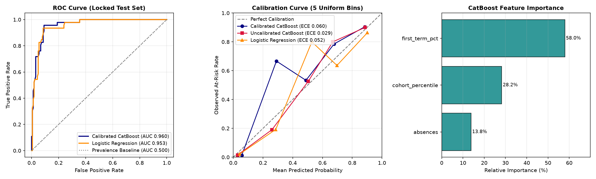

# CatBoost At-Risk Early-Warning Model — Evaluation Report

Generated: 2026-10-06 10:36 UTC

## 1. Study Overview & Methodological Safeguards

- **Project:** Intelligent Parent Dashboard System for Early Learner Intervention Using CatBoost
- **Problem Formulation:** Early-warning prediction of student academic failure using only data available at Period 1.
- **Dataset:** UCI Student Performance (Cortez & Silva, 2008), combining Mathematics (395 records) and Portuguese (649 records) classes (Total: 1044 records across 662 unique student identity groups).
- **Target:** `at_risk = 1` if final grade $G3 < 10/20$ (benchmark failure threshold), `0` otherwise.
  - *Context clarification:* The $G3 < 10$ cutoff is strictly an empirical UCI benchmark failure mark under the Portuguese 20-point scale. It is NOT a Kenyan grading, CBC, or KCSE threshold.
- **Leakage Prevention:**
  - $G2$ (second-term assessment) has been completely eradicated from features, eliminating temporal lookahead leakage.
  - All features represent only information available at Period 1.
  - Outer data split uses `StratifiedGroupKFold(n_splits=5, shuffle=True, random_state=42)` across 13 student demographic attributes, guaranteeing that the same student appearing in both subjects is never present in both training and test sets.
  - Percentile rankings are computed strictly within training folds, ensuring zero reference-pool leakage.

## 2. Dataset Split & Class Distribution

- **Development Pool:** 835 records (530 unique students), At-risk prevalence: 22.0% (184 at risk).
- **Locked Test Set:** 209 records (132 unique students), At-risk prevalence: 22.0% (46 at risk).
- **Student Group Overlap:** Exactly 0 overlapping student identities between Development Pool and Test Set.

## 3. Predictor Set (Period 1 Only)

| Feature | Type | Source & Formula | Dashboard Mapping |
|---|---|---|---|
| `first_term_pct` | Continuous | $G1 / 20 \times 100$ | First assessment percentage |
| `cohort_percentile` | Continuous | Grouped by `(school, subject)` on `first_term_pct`: $(N_{<} + 0.5 N_{=}) / N \times 100$ | CohortPercentile service |
| `absences` | Discrete | Total student absences | Attendance records (status "Absent") |

## 4. Inner Cross-Validation (Development Pool, 4 Grouped Folds)

Metrics across 4 out-of-fold validation splits on the Development Pool (mean ± std):

| Model | brier_score | log_loss | roc_auc | pr_auc | accuracy | precision | recall | f1 |
|---|---|---|---|---|---|---|---|---|
| CatBoost | 0.0855 ± 0.0082 | 0.2753 ± 0.0171 | 0.9344 ± 0.0090 | 0.7847 ± 0.0409 | 0.8731 ± 0.0087 | 0.7381 ± 0.0383 | 0.6630 ± 0.0392 | 0.6969 ± 0.0191 |
| Logistic regression (baseline) | 0.0831 ± 0.0068 | 0.2613 ± 0.0135 | 0.9364 ± 0.0069 | 0.8106 ± 0.0311 | 0.8850 ± 0.0113 | 0.7650 ± 0.0261 | 0.6902 ± 0.0322 | 0.7255 ± 0.0283 |

## 5. Locked Test Set Evaluation

Performance of all benchmark models on the untouched test set (N=209):

| Model | brier_score | log_loss | roc_auc | pr_auc | accuracy | precision | recall | f1 |
|---|---|---|---|---|---|---|---|---|
| Prevalence Baseline | 0.1717 | 0.5270 | 0.5000 | 0.2201 | 0.7799 | 0.0000 | 0.0000 | 0.0000 |
| Logistic regression (baseline) | 0.0703 | 0.2624 | 0.9534 | 0.8082 | 0.9043 | 0.7955 | 0.7609 | 0.7778 |
| CatBoost (Uncalibrated) | 0.0666 | 0.2193 | 0.9599 | 0.8517 | 0.8995 | 0.7778 | 0.7609 | 0.7692 |
| CatBoost (Calibrated - Platt) | 0.0670 | 0.2298 | 0.9599 | 0.8517 | 0.8995 | 0.7907 | 0.7391 | 0.7640 |

*Decision threshold for binary metrics (Accuracy, Precision, Recall, F1): 0.5*

### Calibrated CatBoost Confusion Matrix (Locked Test Set)

| | Predicted Not at Risk ($\\hat{y}=0$) | Predicted At Risk ($\\hat{y}=1$) | Total |
|---|---|---|---|
| **Actually Not at Risk ($y=0$)** | 154 (True Negatives) | 9 (False Positives) | 163 |
| **Actually At Risk ($y=1$)** | 12 (False Negatives) | 34 (True Positives) | 46 |
| **Total** | 166 | 43 | 209 |

## 6. Probability Calibration Analysis (Platt Scaling)

- **Calibrator Architecture:** Sigmoid Platt scaling ($\\text{LogisticRegression}(C=10^5)$) fitted on 835 Out-of-Fold (OOF) probabilities from inner cross-validation.
- **Calibrator Parameters:** Slope ($w$): 6.0160, Intercept ($b$): -3.2113.
- **Expected Calibration Error (ECE):** 0.0601 (6.01%)
- **Maximum Calibration Error (MCE):** 0.3765 (37.65%)

### Reliability Table (5 Uniform Bins on Test Set)

| Probability Bin | Test Count | Mean Predicted Prob | Observed At-Risk Rate | Absolute Error |
|---|---|---|---|---|
| [0.0, 0.2) | 150 | 0.0572 | 0.0133 | 0.0439 |
| [0.2, 0.4) | 9 | 0.2901 | 0.6667 | 0.3765 |
| [0.4, 0.6) | 15 | 0.4887 | 0.5333 | 0.0446 |
| [0.6, 0.8) | 14 | 0.6783 | 0.7857 | 0.1074 |
| [0.8, 1.0] | 21 | 0.8847 | 0.9048 | 0.0201 |

## 7. Feature Importance (CatBoost)

- `first_term_pct`: 57.96%
- `cohort_percentile`: 28.24%
- `absences`: 13.80%

## 8. Evaluation Visualizations

## 9. Academic Limitations & Contextual Discussion

1. **Benchmark vs. Deployment Context:** The training data originates from two Portuguese secondary schools (Cortez & Silva, 2008) under a 20-point system. Although normalized to percentages (0-100%), the model has not yet been fine-tuned on Kenyan educational data (CBC / KCSE).
2. **Absences Horizon Limitation:** In the UCI dataset, `absences` reflects full-year cumulative attendance. In live early-warning deployment at Period 1, observed absences will naturally be lower than full-year counts. Calibration adjustments or annualized attendance rates should be considered during live deployment.
3. **Sociological & Behavioral Exclusion:** High-dimensional family and sociological factors were deliberately omitted to ensure strict computability from basic school operational databases and avoid algorithmic demographic bias.
4. **Decision Support Nature:** The model outputs an advisory probability for early parental and teacher intervention, not an autonomous high-stakes academic determination.
